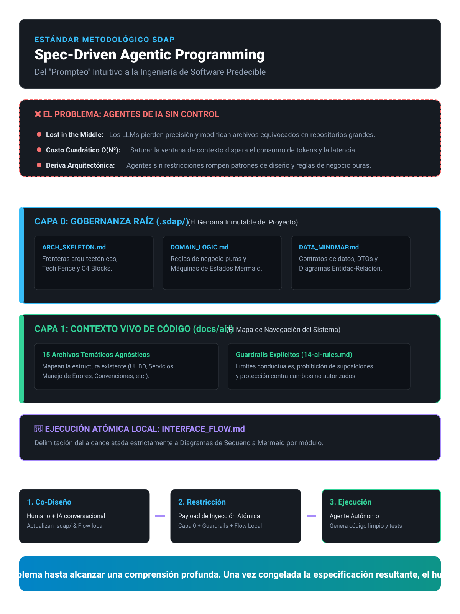

# 🚀 SDAP: Spec-Driven Agentic Programming

> **El estándar metodológico que transforma el "prompteo" informal en ingeniería de software predecible, segura y auditable.**

*(Figura 1: Arquitectura de Doble Capa y Flujo de Ejecución Atómica SDAP)*

---

### 💡 ¿De qué trata esta metodología?

**Spec-Driven Agentic Programming (SDAP)** es un marco de trabajo diseñado para controlar, gobernar y dirigir a los Agentes autónomos de IA durante el desarrollo integral de software (Backend, Datos y Frontend).

En lugar de darle instrucciones ambiguas a la IA y dejar que modifique archivos libremente, SDAP establece una premisa fundamental:
> **"El humano y la IA co-evolucionan el contexto y el problema hasta alcanzar una comprensión profunda. Una vez congelada la especificación resultante, el humano restringe y la IA ejecuta de forma determinista."**

#### 🛡️ Pilares Principales:
* **Capa 0 (`.sdap/`):** El "genoma inmutable" del proyecto. Compuesto por una suite de 6 artefactos de gobernanza:
  1. `ARCH_SKELETON.md`: Esqueleto técnico, Tech Fence y Diagrama C4 Contenedores.
  2. `DOMAIN_LOGIC.md`: Reglas de negocio puras y Diagramas de Máquinas de Estado.
  3. `DATA_MINDMAP.md`: Esquemas de datos, DTOs y Diagrama ERD.
  4. `USE_CASES.md`: Especificación formal de casos de uso, actores, pre/postcondiciones y excepciones.
  5. `SCREEN_FLOW.md`: Arquitectura de UI, grafo de navegación (Wireflow), rutas declarativas y estados visuales.
  6. `INTERFACE_FLOW.md`: Flujos de interacción con Diagramas de Secuencia numerados.
* **Capa 1 (`docs/ai/`):** Un mapa de 15 archivos temáticos que le enseñan a la IA cómo navegar y entender la estructura del código existente.
* **Ejecución Atómica Multidimensional:** Cada tarea se delimita por la intersección de un Caso de Uso, un Diagrama de Secuencia, una Pantalla de UI y sus Guardrails. La IA solo modifica lo estrictamente necesario, reduciendo costos de tokens y eliminando la deriva de código.
