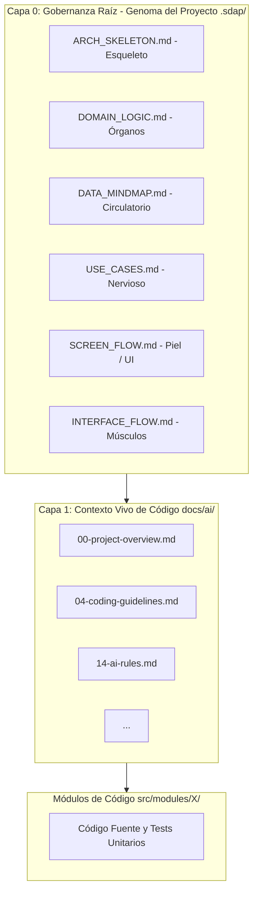

# CAPÍTULO II: EL MARCO METODOLÓGICO SDAP (LA TEORÍA)

## 2.1. Fase de Co-Diseño Dialéctico (*Human-AI Inception*)

La Fase de Co-Diseño Dialéctico, denominada dentro de este marco como *Human-AI Inception*, constituye la etapa de divergencia, exploración y refinamiento conceptual de la metodología SDAP. En la ingeniería de software tradicional, el proceso de descubrimiento y definición de requisitos padece de asimetrías de información, imprecisiones del lenguaje natural y sesgos cognitivos humanos. *Human-AI Inception* transforma esta etapa en un proceso dialéctico estructurado entre el ingeniero y un LLM operando como un **compañero de razonamiento**, actuando como un compilador de ideas antes de la escritura de cualquier línea de código fuente.

El objetivo fundamental de esta fase no es obtener una respuesta rápida, sino elevar progresivamente la calidad del contexto compartido para que el problema, el objetivo y la solución evolucionen conjuntamente hasta alcanzar una comprensión profunda. Este procedimiento se estandariza a través de un protocolo de cuatro etapas secuenciales e iterativas:

1. **Establecimiento del Alcance Teórico (*The Scope Prompt*):** El desarrollador introduce el problema de negocio y la hipótesis inicial sin solicitar implementaciones de código. El modelo es forzado a proponer múltiples alternativas arquitectónicas evaluando pros, contras y posibles cuellos de botella.
2. **Bucle de Cuestionamiento Crítico (*Challenge Loop & Bucle "¿Y si pensamos un poco más?"*):** El ingeniero y la IA someten las propuestas a pruebas de estrés conceptuales. El humano cuestiona las asunciones del modelo y el modelo reta los sesgos del humano. En esta etapa emerge el **Objetivo Emergente (*Emergent Goal*)**, redefiniendo la naturaleza del problema original a medida que la calidad del contexto se incrementa.
3. **Congelamiento de Contexto (*The Freezing Prompt*):** Una vez alcanzada la comprensión profunda y seleccionada la ruta óptima, se congela la exploración creativa. Se le ordena a la IA sintetizar el histórico de la conversación, depurar las contradicciones y estructurar los requisitos funcionales purificados.
4. **Cristalización de Artefactos en la Capa 0:** La IA traduce el entendimiento abstracto de la sesión en especificaciones técnicas concretas en formato Markdown y diagramas Mermaid. En este punto, la sesión conversacional concluye y el conocimiento se transfiere de la memoria volátil a los archivos inmutables del repositorio en el directorio `.sdap/`.

---

## 2.2. La Arquitectura Hexagonal de Documentación y la Doble Capa

El pilar estructural de SDAP es la sustitución del "Documento Maestro de Requisitos" tradicional por una **Arquitectura Hexagonal de Documentación Raíz**. Los documentos de texto extensos y monolíticos inducen fallos de atención en las IAs debido al fenómeno *Lost in the Middle*. SDAP propone una fragmentación granular del conocimiento técnico en archivos Markdown de tamaño acotado, distribuidos en dos capas principales de abstracción:

### 2.2.1. Capa 0: Gobernanza Raíz (`.sdap/`)
Constituye el "Genoma Inmutable del Proyecto". Se compone de seis artefactos de gobernanza integral:

* **`ARCH_SKELETON.md` (El Esqueleto):** Ubicado en `.sdap/`. Contiene el mapa de cohesión inmutable del software: descripción del sistema, fronteras tecnológicas explícitas (*Tech Fence*), el patrón arquitectónico global y los límites modulares.
* **`DOMAIN_LOGIC.md` (Los Órganos):** Ubicado en `.sdap/`. Almacena las reglas de negocio puras, restricciones funcionales, invariantes y modelos de comportamiento lógico de las entidades del sistema.
* **`DATA_MINDMAP.md` (El Sistema Circulatorio):** Ubicado en `.sdap/`. Define los contratos de datos, los esquemas de bases de datos, las firmas de entidades y los DTOs de comunicación. Garantiza la consistencia en el tipado y transporte de información.
* **`USE_CASES.md` (El Sistema Nervioso):** Ubicado en `.sdap/`. Especifica formalmente los casos de uso por actor: precondiciones, disparadores, flujos principales (*Happy Path*), flujos alternos/excepciones, postcondiciones y reglas de negocio asociadas.
* **`SCREEN_FLOW.md` (La Piel / Interfaz):** Ubicado en `.sdap/`. Modela el grafo de navegación (Wireflow), la tabla de rutas declarativas, el catálogo de pantallas/modales y la matriz de estados de vista (`Loading`, `Idle`, `Empty`, `Error`).
* **`INTERFACE_FLOW.md` (Los Músculos):** Ubicado en `.sdap/` y/o a nivel local de módulo. Detalla la interacción secuencial y el orden de ejecución técnica entre componentes del sistema.

### 2.2.2. Capa 1: Contexto Vivo de Código (`docs/ai/`)
Si la Capa 0 define el *qué*, el *por qué*, el *quién* y el *dónde en la interfaz*, la Capa 1 mapea el *cómo* en el código existente. Consiste en un conjunto estructurado de 15 archivos agnósticos a la tecnología que sirven como mapa del código existente para el agente autónomo (convenciones de nombrado, inyección de dependencias, patrones de interfaz, reglas de comportamiento y guías para añadir funcionalidades).

---

## 2.3. Modelado Visual para IAs: Mermaid como Lenguaje de Abstracción Lógica

Una de las contribuciones conceptuales más disruptivas de SDAP es la formalización de herramientas visuales basadas en texto como el canal primario de instrucción para modelos de lenguaje. Los diagramas gráficos tradicionales (PNG, JPEG) representan cajas negras de información para los mecanismos de atención, mientras que el código estructurado de **Mermaid** proporciona lógica proposicional directa y relacional de alta densidad semántica con un consumo mínimo de tokens.

SDAP estipula la correspondencia obligatoria de un tipo de diagrama Mermaid para cada documento de la gobernanza raíz:

* En `ARCH_SKELETON.md` se exige un **Diagrama de Bloques (C4 Contenedores)** para modelar la topología del sistema.
* En `DOMAIN_LOGIC.md` se exige un **Diagrama de Máquina de Estados (State Machine)**. Este gráfico es crítico para agentes autónomos, ya que mapea las transiciones válidas de las entidades de negocio, eliminando bugs de lógica operacional.
* En `DATA_MINDMAP.md` se implementa un **Diagrama de Entidad-Relación (ERD)** que restringe las consultas y la estructura de persistencia del modelo.
* En `USE_CASES.md` se despliega un **Diagrama de Actores y Casos de Uso (`flowchart LR`)** que delimita la relación entre actores humanos/sistemas y sus objetivos operacionales.
* En `SCREEN_FLOW.md` se despliega un **Grafo de Navegación / Wireflow (`flowchart TD`)** que enlaza rutas, pantallas y modales.
* En `INTERFACE_FLOW.md` se despliega un **Diagrama de Secuencia** secuencial y numerado, detallando el flujo exacto de llamadas entre componentes.

Al procesar la sintaxis de Mermaid, los LLMs indexan las relaciones de interdependencia de los componentes antes de evaluar las líneas de código, reduciendo la ambigüedad técnica a cero.

---

## 2.4. Principio de Ejecución Atómica Multidimensional

El cierre operativo de la teoría SDAP es el **Principio de Ejecución Atómica Multidimensional**. El error fundamental del uso de agentes de desarrollo actuales radica en proveer instrucciones ambiguas de amplio espectro, lo que fragmenta la atención del agente y produce respuestas truncadas, alucinaciones o parches redundantes.

Este principio dicta que **toda tarea delegada a una IA debe poseer un alcance strictly delimitado por la intersección de sus especificaciones formales**:

$$ \text{Alcance de Ejecución} = f(\text{Diagrama Secuencia } X) \cap f(\text{Caso de Uso } W) \cap f(\text{Pantalla UI } S) \cap f(\text{Entidad ERD } Y) \cap f(\text{Regla Guardrail } Z) $$

Al aplicar esta restricción multidimensional, el agente tiene prohibido proponer o modificar código fuera de las interacciones descritas explícitamente en el alcance delimitado. El impacto científico de este principio es doble:

1. **Aislamiento de Contexto:** El agente reduce su ventana de procesamiento al subconjunto atómico necesario, ignorando el ruido del resto de la aplicación y preservando la ventana de atención.
2. **Determinismo Estocástico Fullstack:** Al estar resueltos tanto el flujo de usuario (`USE_CASES`), la vista y sus estados (`SCREEN_FLOW`), como la secuencia técnica (`INTERFACE_FLOW`), las capacidades del LLM se canalizan únicamente en la traducción exacta hacia código limpio, verificable y tipado.
