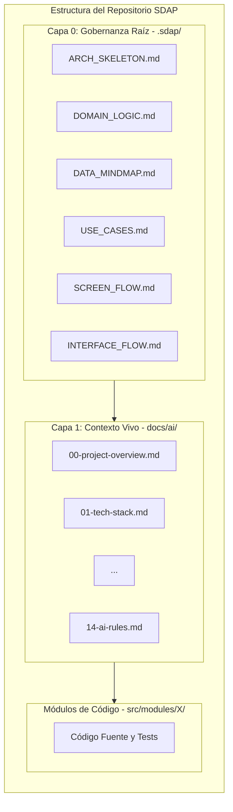

# CAPÍTULO III: LA ESTRUCTURA DE INFORMACIÓN SDAP (APLICACIÓN PRÁCTICA)

## 3.1. Visión General de la Arquitectura de Información

El estándar **Spec-Driven Agentic Programming (SDAP)** organiza el conocimiento de un repositorio de software en una estructura de información jerárquica de dos capas. Esta arquitectura garantiza que los agentes de IA dispongan del contexto necesario para operar con máxima precisión en Backend, Datos y Frontend, eliminando la ambigüedad y previniendo la degradación del código fuente.

## 3.2. Capa 0: Gobernanza Raíz y Genoma del Proyecto (`.sdap/`)

La **Capa 0** se aloja en el directorio `.sdap/` en la raíz del repositorio. Constituye la "Constitución Inmutable" de la aplicación, cristalizada durante la Fase de Incepción Dialéctica. Ningún agente autónomo está autorizado a violar las reglas, contratos, casos de uso ni arquitecturas visuales definidas en esta capa.

### 3.2.1. `ARCH_SKELETON.md` (El Esqueleto Arquitectónico)
Define la estructura global del sistema, los límites de las capas y la valla tecnológica (*Tech Fence*).
* **Objetivo:** Prevenir que el agente introduzca librerías no autorizadas o modifique el patrón arquitectónico base.
* **Componentes Clave:** Descripción general del patrón (ej. Clean Architecture, Hexagonal, CQRS, BFF), lista explícita de tecnologías y versiones permitidas (*Tech Fence*), Diagrama Mermaid de Contenedores/Bloques (C4) y límites de módulos.

### 3.2.2. `DOMAIN_LOGIC.md` (Las Reglas de Negocio)
Centraliza la lógica de dominio pura, desacoplada de cualquier implementación tecnológica o base de datos.
* **Objetivo:** Evitar que la IA implemente reglas de negocio arbitrarias o inconsistentes con los requisitos del producto.
* **Componentes Clave:** Glosario de términos del dominio (*Ubiquitous Language*), reglas de negocio e invariantes inmutables catalogadas ($R_1 \dots R_n$) y Diagramas Mermaid de Máquina de Estados (*State Machine*).

### 3.2.3. `DATA_MINDMAP.md` (Los Contratos y Modelos de Datos)
Mapea las estructuras de información, esquemas de bases de datos e interfaces de transporte.
* **Objetivo:** Garantizar la consistencia del tipado, esquemas e integridad referencial.
* **Componentes Clave:** Definición de Entidades, Modelos y Value Objects, Diagrama Mermaid de Entidad-Relación (ERD), Contratos de transferencia (DTOs y eventos) y reglas de integridad/índices.

### 3.2.4. `USE_CASES.md` (Los Casos de Uso y Actores)
Especifica la intención y los flujos operacionales de los usuarios y sistemas.
* **Objetivo:** Servir de puente riguroso entre las reglas de dominio y la ejecución técnica, evitando que el agente invente comportamientos no contemplados.
* **Componentes Clave:** Catálogo formal de casos de uso ($CU_{01} \dots CU_n$) agrupados por actor y módulo, Diagrama Mermaid de Actores y Casos de Uso (`flowchart LR`), y estructura formal: Actor principal, Precondiciones, Disparador (*Trigger*), Flujo Principal (*Happy Path*), Flujos Alternos/Excepciones, Postcondiciones y Reglas de Negocio vinculadas.

### 3.2.5. `SCREEN_FLOW.md` (La Arquitectura de UI y Pantallas)
Mapea el árbol completo de navegación, rutas declarativas y estados de la interfaz de usuario.
* **Objetivo:** Eliminar la deriva visual y funcional en clientes (móviles y web), previniendo rutas huérfanas, modales improvisados y estados UI no sincronizados.
* **Componentes Clave:** Grafo de Navegación Global / Wireflow en Mermaid (`flowchart TD`), tabla maestra de rutas declarativas (contrato del Router: path, guard, acceso), catálogo detallado de pantallas, BottomSheets y modales, matriz canónica de 4 estados de pantalla (`Loading/Skeleton`, `Data/Idle`, `Empty State`, `Error/Retry`) y matriz de trazabilidad: Pantalla $\leftrightarrow$ Caso de Uso $\leftrightarrow$ DTO.

### 3.2.6. `INTERFACE_FLOW.md` (Los Flujos Técnicos de Interacción)
Detalla la coreografía técnica y la secuencia de comunicación entre capas y servicios externos.
* **Objetivo:** Acotar el orden exacto de llamadas (HTTP, websockets, base de datos, push) para tareas atómicas.
* **Componentes Clave:** Diagramas de Secuencia Mermaid numerados (`autonumber`), tabla de casos límite técnicos y códigos de respuesta, y tabla de delimitación de alcance con columnas "Módulo", "Diagrama" y "Prohibido tocar".

---

## 3.3. Capa 1: Contexto Vivo de Código (`docs/ai/`)

Ubicada en `docs/ai/`, la **Capa 1** consta de 15 archivos estandarizados y agnósticos a la tecnología. Actúa como el mapa de navegación que el agente consulta para entender *cómo* está construido el software y *dónde* realizar los cambios.

### 3.3.1. Índice Estructurado de los 15 Archivos de Contexto

| Archivo | Nombre | Propósito Metodológico |
| :--- | :--- | :--- |
| `00` | `project-overview.md` | Resumen ejecutivo, propósito del software y arquitectura general. |
| `01` | `tech-stack.md` | Detalle del stack técnico, versiones, runtimes y herramientas de soporte. |
| `02` | `folder-structure.md` | Árbol del proyecto y guía de ubicación de archivos según su responsabilidad. |
| `03` | `architecture-patterns.md` | Explicación detallada del patrón de diseño implementado (ej. Ports & Adapters, Riverpod). |
| `04` | `coding-guidelines.md` | Convenciones de nombrado, estilo de código y estándares de formateo. |
| `05` | `ui-patterns.md` | Estándares de componentes UI, design system y gestión de estado de widgets. |
| `06` | `data-flow.md` | Ciclo de vida de las peticiones desde la entrada hasta la persistencia. |
| `07` | `services-layer.md` | Especificación de servicios de aplicación, casos de uso y orquestación. |
| `08` | `database-orm.md` | Estrategias de persistencia, migraciones, consultas e indexación. |
| `09` | `error-handling.md` | Estructura de excepciones, códigos de error y respuestas estandarizadas. |
| `10` | `auth-security.md` | Protocolos de autenticación, autorización, RBAC y manejo de secretos. |
| `11` | `testing-strategy.md` | Estrategia de pruebas unitarias, de integración, mocks y cobertura mínima. |
| `12` | `dependencies.md` | Gestión de paquetes externos, módulos compartidos y políticas de actualización. |
| `13` | `how-to-add-features.md` | Algoritmo paso a paso para que el agente añada una nueva funcionalidad. |
| `14` | `ai-rules.md` | Lista de barreras de contención (*Guardrails*) y prohibiciones explícitas para la IA. |

---

## 3.4. Ciclo de Vida del Contexto y Sincronización Inversa (*Reverse Sync*)

El verdadero valor del contexto vivo radica en prevenir la "obsolescencia de la documentación". En SDAP, si una ejecución atómica altera la estructura de carpetas, añade una dependencia o modifica un patrón de respuesta, se activa el protocolo de **Sincronización Inversa (*Reverse Sync*)**:

1. **Escribir Código:** El agente ejecuta la tarea atómica delimitada.
2. **Evaluación de Impacto en Contexto:** El agente o desarrollador identifica si el cambio afectó alguno de los 15 archivos de `docs/ai/`.
3. **Actualización del Mapa Vivo:** Antes de dar por concluido el Pull Request, el agente actualiza los archivos correspondientes en `docs/ai/` (por ejemplo, añadiendo la nueva dependencia a `12-dependencies.md`).

---

## 3.5. Protocolo de Inyección Multidimensional de Contexto para Agentes

Para optimizar el uso de la ventana de contexto y prevenir el fenómeno *Lost in the Middle*, la selección de archivos inyectados al agente debe realizarse bajo el siguiente criterio de filtrado multidimensional:

$$ \text{Payload Inyectado} = \{ \text{Extracto de .sdap/ (Regla + DTO + Caso de Uso + Pantalla)}, \; \text{docs/ai/14-ai-rules.md}, \; \text{docs/ai/04-coding-guidelines.md}, \; \text{INTERFACE_FLOW relevante} \} $$

Este enfoque garantiza que el agente reciba únicamente las restricciones inmutables y el mapa del cambio local, maximizando la precisión del código generado y reduciendo al mínimo el consumo de tokens.
