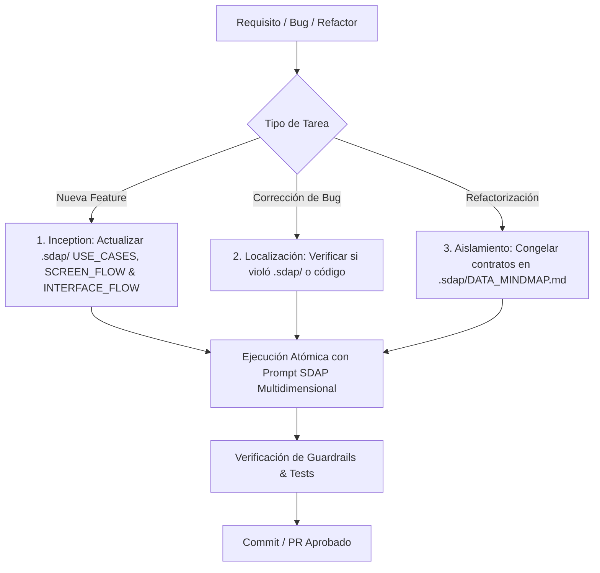

# CAPÍTULO IV: PROTOCOLOS DE INYECCIÓN, GUÍA OPERATIVA Y EVALUACIÓN

## 4.1. El Protocolo de Inyección de Contexto (*Context Injection Protocol*)

El éxito del estándar **Spec-Driven Agentic Programming (SDAP)** radica en transformar la interacción con el agente en un proceso determinista y acotado. Para evitar que el Modelo de Lenguaje (LLM) caiga en el fenómeno *Lost in the Middle* o sufra degradación por saturación de tokens, SDAP establece un protocolo estricto de empaquetado de payload para los prompts de ejecución mediante etiquetas del tipo XML.

### 4.1.1. Estructura Estándar del Payload Multidimensional
Cada invocación orientada a tareas de código (*task execution*) debe componerse de bloques lógicos bien definidos, delimitados por etiquetas tipo XML para maximizar la capacidad de parséo semántico de los transformadores:

```xml
<sdap_context>
  <!-- BLOQUE 1: RESTRICCIONES INMUTABLES DE GOBERNANZA (CAPA 0) -->
  <governance_rules>
    [Extracto relevante de .sdap/ARCH_SKELETON.md - Tech Fence y Arquitectura]
    [Extracto relevante de .sdap/DOMAIN_LOGIC.md - Reglas de Negocio R_x]
    [Contratos de datos relevantes de .sdap/DATA_MINDMAP.md - DTOs/ERD]
  </governance_rules>

  <!-- BLOQUE 2: ALCANCE FUNCIONAL Y ACTORES (CAPA 0) -->
  <functional_boundary>
    [Caso de Uso específico de .sdap/USE_CASES.md - Pre/Postcondiciones y Flujo]
  </functional_boundary>

  <!-- BLOQUE 3: ALCANCE VISUAL Y RUTAS (CAPA 0 - SOLO SI APLICA A UI/FRONTEND) -->
  <ui_boundary>
    [Especificación de Pantalla y Estados de .sdap/SCREEN_FLOW.md - SCR_x]
  </ui_boundary>

  <!-- BLOQUE 4: BARRERAS DE CONTENCIÓN (CAPA 1) -->
  <guardrails>
    [Contenido de docs/ai/14-ai-rules.md]
    [Contenido de docs/ai/04-coding-guidelines.md]
  </guardrails>

  <!-- BLOQUE 5: DELIMITACIÓN LOCAL DE LA SECUENCIA TÉCNICA -->
  <execution_boundary>
    [Diagrama de Secuencia de .sdap/INTERFACE_FLOW.md correspondiente al módulo]
  </execution_boundary>

  <!-- BLOQUE 6: INSTRUCCIÓN ATÓMICA DE EJECUCIÓN -->
  <task_instruction>
    [Descripción puntual del objetivo, haciendo referencia explícita al Caso de Uso y al Diagrama de Secuencia]
  </task_instruction>
</sdap_context>
```

---

## 4.2. Plantilla Estandarizada del Prompt de Ejecución (The SDAP Prompt)

A continuación se define la plantilla oficial de instrucción que el desarrollador (o la herramienta de orquestación) debe proveer al agente autónomo para la ejecución de una tarea de desarrollo:

### ROL Y MODO DE OPERACIÓN
Actúas como un Agente de Ejecución de Código estricto bajo la metodología Spec-Driven Agentic Programming (SDAP).
Tu único objetivo es implementar la tarea descrita sin desviarte de las fronteras arquitectónicas, de los contratos de datos, de los casos de uso ni de las pantallas definidas.

### REGLAS DE GOBERNANZA (INMUTABLES)
1. **Tech Fence:** No puedes agregar dependencias, librerías o paquetes externos no autorizados en `<governance_rules>`.
2. **Domain Logic:** Las reglas de validación y estados definidos en la máquina de estados de dominio son inviolables.
3. **Functional Boundary:** No puedes inventar validaciones, permisos ni excepciones fuera del caso de uso definido en `<functional_boundary>`.
4. **UI Boundary:** En tareas de frontend, respeta las rutas declarativas y la matriz de 4 estados de pantalla (`Loading`, `Idle`, `Empty`, `Error`) definidos en `<ui_boundary>`.
5. **Boundary Control:** Solo estás autorizado a modificar o crear archivos dentro del alcance definido en `<execution_boundary>`. Prohibido refactorizar o tocar código fuera de esta frontera.

### TAREA A EJECUTAR
- **Objetivo:** Implementar el paso [Nº] del Diagrama de Secuencia para el Caso de Uso [CU-XX] (y Pantalla [SCR-XX] si es UI).
- **Entrada esperada:** [Especificar DTO/Entidad de entrada].
- **Salida esperada:** [Especificar DTO/Widget/Respuesta esperada].

### INSTRUCCIÓN DE COMPORTAMIENTO
Analiza el flujo en `<execution_boundary>`, verifica las barreras de contención en `<guardrails>` y genera únicamente el código fuente necesario, acompañado de sus correspondientes pruebas unitarias bajo las convenciones del proyecto.

---

## 4.3. Casos de Uso Prácticos y Flujos de Trabajo (Workflows)

SDAP no solo rige la creación de código nuevo, sino que proporciona flujos de trabajo estandarizados para las operaciones habituales del ciclo de vida del software.



### 4.3.1. Caso de Uso A: Implementación de una Nueva Funcionalidad (*New Feature*)
* **Fase Inception Dialéctica:** El humano y la IA conversacional actualizan `.sdap/DOMAIN_LOGIC.md` si hay nuevas reglas, incorporan el caso de uso en `.sdap/USE_CASES.md`, definen la pantalla en `.sdap/SCREEN_FLOW.md` y crean el `INTERFACE_FLOW.md` del nuevo módulo.
* **Empaquetado Atómico:** Se inyecta la Capa 0, los guardrails (`docs/ai/14-ai-rules.md`) y las delimitaciones funcionales locales.
* **Ejecución y Sincronización:** El agente genera el código y activa *Reverse Sync* actualizando `docs/ai/` si hubo cambios en la infraestructura o dependencias.

### 4.3.2. Caso de Uso B: Resolución de Incidentes (*Bug Fixing*)
* **Diagnóstico:** Se determina si el bug es por falla local o por un caso de borde no previsto en el dominio.
* **Ajuste de Especificación:** Si el bug reveló un caso de borde (*edge case*) no contemplado, primero se actualiza la especificación en `.sdap/DOMAIN_LOGIC.md` o en `.sdap/USE_CASES.md`.
* **Ejecución Restringida:** Se inyecta la especificación corregida y el fragmento de código afectado. El agente ajusta la implementación asegurando que los tests existentes sigan pasando.

### 4.3.3. Caso de Uso C: Refactorización Controlada
1. **Congelamiento de Contratos:** Se valida que `.sdap/DATA_MINDMAP.md` (interfaces y DTOs) permanezca inmutable.
2. **Inyección de Reglas de Código:** Se enfatiza el archivo `docs/ai/04-coding-guidelines.md` en el payload.
3. **Ejecución:** El agente refactoriza la estructura interna del módulo sin alterar las firmas de las interfaces públicas expuestas en la Capa 0.

---

## 4.4. Barreras de Contención y Prevención de Deriva (*Guardrails*)

Para asegurar que los agentes autónomos operen con alta fidelidad, la Capa 1 define el archivo `docs/ai/14-ai-rules.md`. Este archivo actúa como una lista explícita de directivas relativas a la conducta del modelo:

### 4.4.1. Ejemplos de Guardrails Estándar (`docs/ai/14-ai-rules.md`)
* **Prohibición de Suposiciones Lógicas:** "Si un requisito, caso de uso o contrato de datos es ambiguo, detén la ejecución y solicita aclaración. No asumas campos opcionales ni inventes valores por defecto."
* **Prohibición de Modificaciones Masivas:** "Está estrictamente prohibido modificar archivos de configuración raíz (`package.json`, `pubspec.yaml`, `Dockerfile`) a menos que el prompt lo ordene explícitamente."
* **Preservación de Firma de Métodos:** "Ninguna refactorización local puede alterar las firmas de las interfaces de dominio públicas definidas en `.sdap/DATA_MINDMAP.md`."
* **Preservación de Contratos de Navegación:** "Ningún agente de frontend puede inventar rutas que no existan en `.sdap/SCREEN_FLOW.md`."
* **Cero Código Muerto / TODOs:** "No dejes comentarios `// TODO:` ni bloques de código comentados. Toda implementación debe estar completa o fallar explícitamente mediante excepciones tipadas."

### 4.4.2. El Rol del Agente Auditor (*Red-Teaming Pattern*)
Para garantizar el cumplimiento de la gobernanza, SDAP introduce un patrón de verificación de doble agente:
* **Agente Ejecutor:** Recibe el prompt SDAP y genera el código/PR.
* **Agente Auditor de Gobernanza:** Analiza el `git diff` resultante frente a `.sdap/ARCH_SKELETON.md` y `14-ai-rules.md`. Emite un reporte de aprobación (*PASS/FAIL*) identificando si el Agente Ejecutor cometió violaciones arquitectónicas o introdujo código fuera de la frontera permitida.

---

## 4.5. Métricas de Evaluación Cuantitativa y Conclusiones

Para medir la efectividad de SDAP frente a enfoques empíricos o ad-hoc, el estándar evalúa cuatro métricas cuantitativas clave:

* **Context Retention Rate (CRR):** Porcentaje de reglas de negocio en `.sdap/DOMAIN_LOGIC.md` respetadas sin alucinaciones durante la primera iteración.
* **Token Efficiency Index (TEI):** Relación entre tokens consumidos y líneas de código útil producidas ($Tokens / Lineas$). SDAP busca reducir esta tasa al evitar la inyección de repositorios completos.
* **Architecture Compliance Score (ACS):** Grado de cumplimiento de la valla tecnológica y ausencia de modificaciones no autorizadas fuera del `INTERFACE_FLOW.md` y `SCREEN_FLOW.md`.
* **Iterative Roundtrips to Success (IRS):** Número de intentos o correcciones necesarias por parte del desarrollador para que la solución pase todas las pruebas y revisiones de código.

### Conclusión Final

El estándar **Spec-Driven Agentic Programming (SDAP)** transforma el paradigma del desarrollo asistido por IA, transitando desde un modelo artesanal basado en prompts informales hacia una **disciplina de ingeniería rigurosa, predecible y auditable**.

Al desacoplar la gobernanza inmutable (`.sdap/`) del contexto vivo de código (`docs/ai/`), utilizar diagramas como especificaciones ejecutables (Mermaid) y restringir la ventana de atención del agente mediante la ejecución atómica multidimensional (Backend, Datos, Casos de Uso e Interfaz), SDAP mitiga las limitaciones matemáticas subyacentes en los transformadores (*Lost in the Middle*, $O(N^2)$ en consumo de tokens). Como resultado, la ingeniería de software guiada por especificaciones garantiza que el ser humano mantenga el control arquitectónico estratégico mientras la IA despliega su máxima capacidad en la ejecución técnica limpia.
